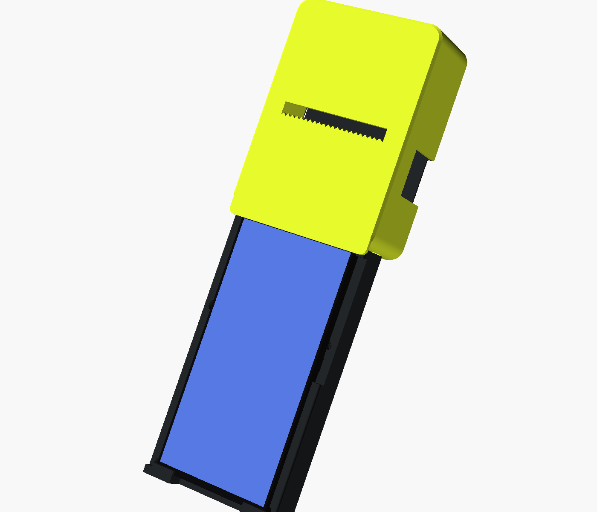
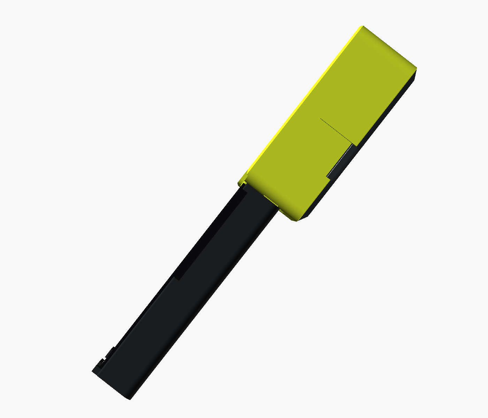
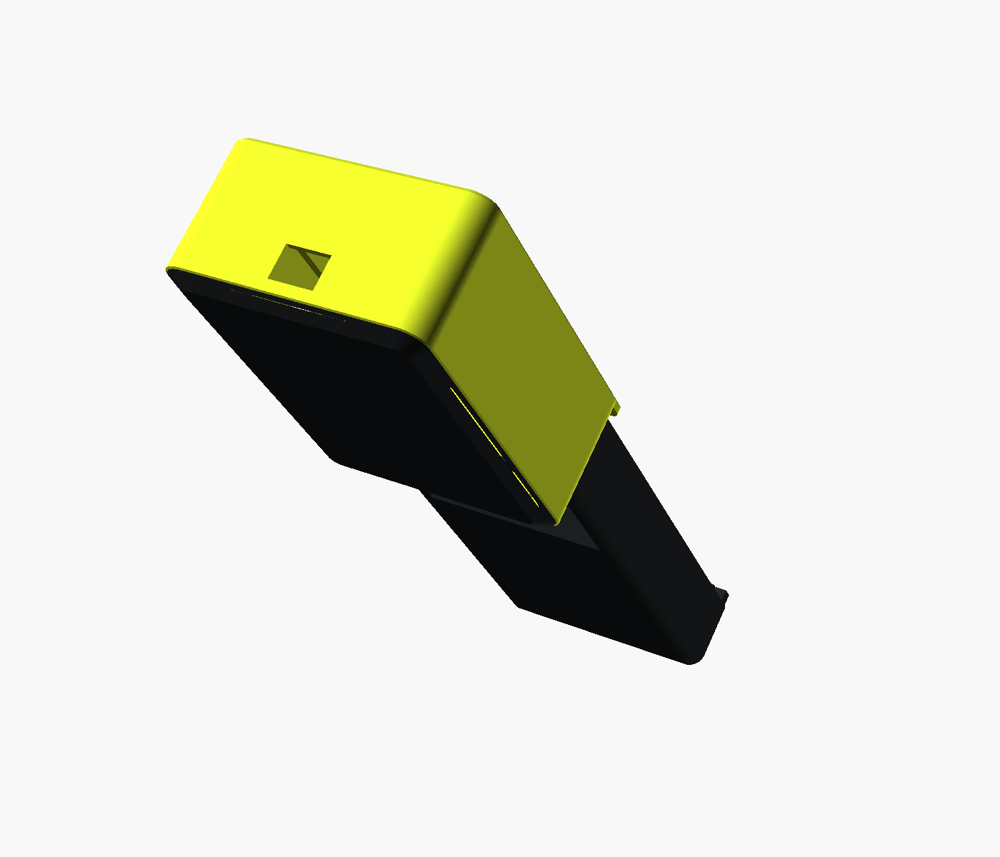
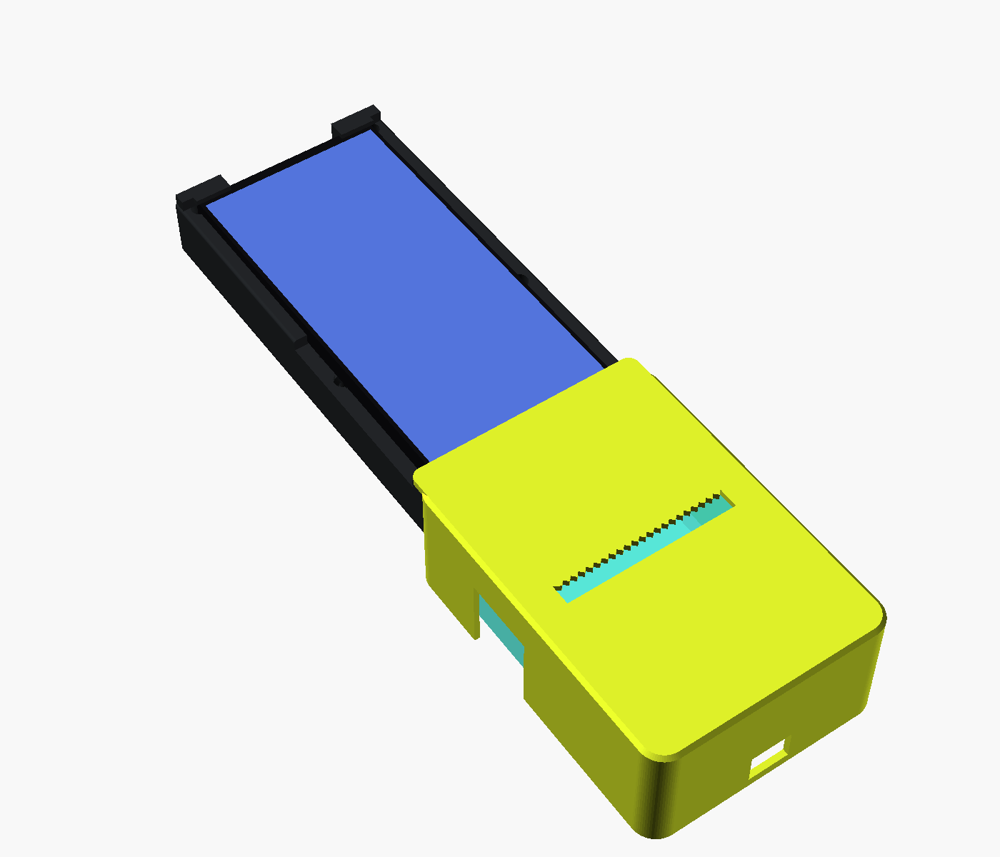
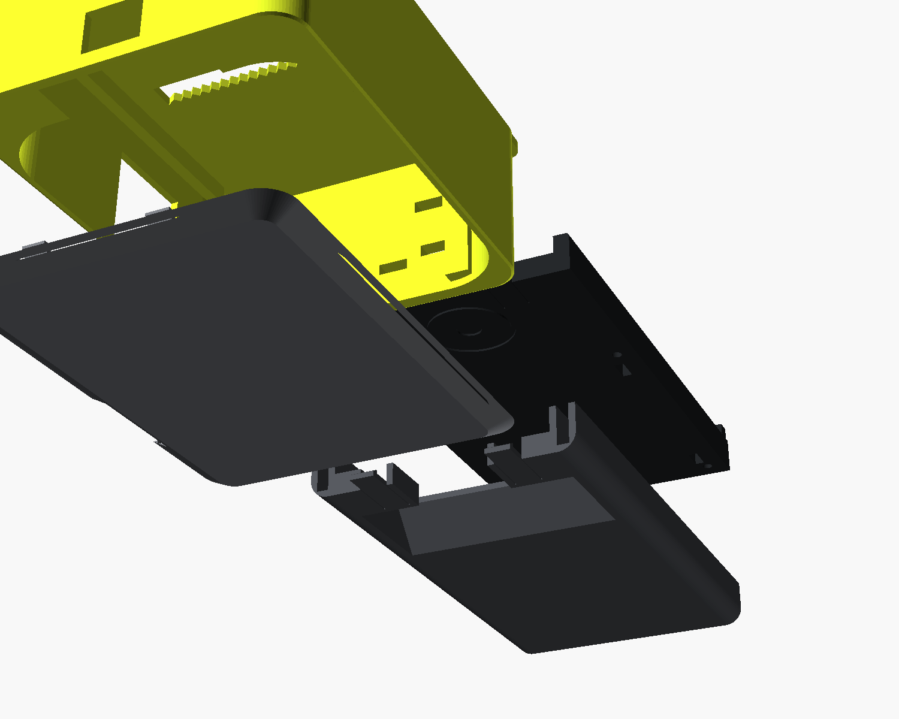

# 3dhaz – hordozható fizetési terminál (Teya PRO felépítés)

MXW01 (Fun Print) mini hőnyomtató + Samsung Galaxy S21 FE (tok nélkül) + mágneses Qi + kis powerbank, egy kézben fogható darabban.
Felül a nyomtató „sapka”, alatta a telefon mint érintőkijelző, ahogy a Teya PRO / SUNMI terminálokon.

| oldalnézet | hátulnézet | belül (sapkafedél nélkül) | szétszedve (pattintók) |
|---|---|---|---|
|  |  |  |  |

## Felépítés
- **Sapka (sárga):** zárt nyomtatóház a telefon tetején. Az elülső pereme 4 mm-en ráül a telefon felső élére, így nincs rés köztük. A nyomtató arccal előre fekszik benne, a blokk a sapka elején, a fogazott tépőélnél jön ki, a kijelzőtől 57 mm-re feljebb.
- **Test:** benne a telefon. A kijelző teljesen szabad: a tálca fala a kijelző síkja alatt marad, alul egy 2 mm-es perem csak a kávát fogja.
- **A telefon mögött:** középen mágneses Qi zseb, alatta powerbank-rekesz. A felső harmad mögött csak műanyag van (7 mm), hátul egy bemélyedéssel a kártyás érintéshez (NFC / Tap to Pay).
- Nincs láb, rúd vagy állvány: az egész egy fogható darab.

## Fő méretek (mm)
| | |
|---|---|
| Teljes | 293 hosszú × 94 széles (sapka) / 87 (test) |
| Vastagság | test 28 (+2 mm kiálló üveg), sapka 51 |
| Kézben / bemutató nézetben | a kijelző kb. 52°-ban dől |
| Telefonzseb | 76,5 × 159,2 (3,5 mm hely a behelyezéshez) |
| Qi + mágnesgyűrű zseb | Ø58 × 6, elölről, közvetlenül a telefon háta mögött; középpontja 72 mm-re a telefon aljától |
| NFC-zóna | a telefon felső 52 mm-e mögött: fém, mágnes és kábel nélkül, 7 mm műanyag, hátul bemélyedés |
| Powerbank-rekesz | 105 × 82 × 12,8 (pl. vékony 5000 mAh-s), a felső harmad alatt; töltőnyílás a test alján |
| Nyomtató-üreg | 89,6 × 107,6 + fülzseb, 45,8 mély; oldalt 4,8 mm kábelhely |
| Papírnyílás | 67 × 8 a sapka elején, fogazott alsó éllel |
| Bekapcsoló ablak (bal) | a nyomtató hátuljától 6–45, aljától 6–38 |
| Papírkinyitó ablak (jobb) | 28 széles, hátrafelé nyitott, a kiálló reteszhez |
| USB-C (fülek között) | 16 × 12 kivágás a sapka tetején, kívülről is dugható |

## Részek (mind ráfér egy 220 × 220-as ágyra, támasz nélkül)
| fájl | mi ez | nyomtatási helyzet |
|---|---|---|
| `stl/terminal_base.stl` / `.3mf` | test eleje: telefontálca + Qi zseb + 2 sapka-nyelv | a lap hátulja az ágyon |
| `stl/terminal_back.stl` / `.3mf` | test hátulja: powerbank-rekesz + 4 rugós kar + 2 sapka-nyelv | hátlappal az ágyon |
| `stl/terminal_top.stl` / `.3mf` | nyomtató-sapka (papírnyílás, ablakok, pattintó-rések) | elejével az ágyon |
| `stl/terminal_lid.stl` / `.3mf` | papírcsere-fedél: 2 zsanér-nyelv + 2 rugós kar | hátlappal az ágyon |

**Anyag: PETG ajánlott.** A PETG szívósabb, és sokkal több nyitást-zárást bír, mint a PLA, ami ridegebb, és a rugós karok tövénél idővel megreped. Javasolt beállítás: 3–4 fal, 20–25 % infill, 0,2 mm réteg.
Forrás: `cad/terminal.scad` (`PART = base | back | top | lid | assembly`). Színes előnézet: `cad/render/view.scad` (`VIEW = hold | inside | exploded`).

## Pattintós rögzítés (csavar és fém nélkül)
Minden kötés a nyomtatott alkatrészek része (cantilever snap-fit). Kampók: kb. 30°-os beszálló rámpa, derékszögű tartóél, 0,3 mm hézag, ékes (filézett) tő. Összerakva kívülről csak a fedél kioldó rései látszanak.

| kötés | hogyan zár | hogyan nyílik | kar | nyúlás* |
|---|---|---|---|---|
| **1. Papírcsere-fedél → sapka** | A fedél felső végén lévő 2 L-nyelvet be kell akasztani a sapka tetőfalának hornyába, a fedelet ráhajtani, és az alsó 2 kar **rákattan**. | A sapka alján, a test mögött lévő **2 kis résen** át a kampókat meg kell nyomni (köröm, toll hegye), és a fedél alja kibillen. | 1,2 mm vastag, ~10 mm szabad hossz | ~1,3 % |
| **2. Test hátulja → test eleje** | Össze kell nyomni: 4 rugós kar bekattan a lap réseibe. | Ki kell venni a telefont: a lapon látszik a 4 rés. A kampókat befelé kell nyomni, és a két felet széthúzni. | 1,6 mm, ~15 mm | ~0,7 % |
| **3. Sapka → test** | Rá kell tolni a sapkát a test tetejére: 4 lapos nyelv (2 a lapból, 2 a hátból) a sapka alsó falába **kattan**. | Fedél le, nyomtató ki, és belülről a 4 nyelv kampóját le kell nyomni, majd a sapkát lehúzni. | 1,6 mm, ~16–18 mm | ~0,5–0,6 % |

\* Kb. 0,7 mm kampó-beakadásnál számolva (ε ≈ 1,5·vastagság·lehajlás/hossz²). PETG-nél tartósan 2 % alatt érdemes maradni, PLA-nál 1 % alatt.

**Nyomtatási irány:** a sapkát rögzítő nyelvek az ágyon fekve, XY-ban készülnek, így a rétegek mentén hajlanak, ez a legerősebb eset. A test-hát és a fedél karjai függőlegesen nyomtatódnak, mert a záródás iránya ezt adja. Ezért ezeket hosszúra és vékonyra méreteztem, így a nyúlás kicsi marad.

**Tartalék:** a test eleje és hátulja között megmaradt 4 db opcionális M3 furat (süllyesztett, a telefon alatt, a felső harmadon kívül). Alapból nem kellenek. A sapkánál és a fedélnél nincs csavar.

## Összeszerelés
1. **Qi modul** (kerek, mágnesgyűrűs, Ø50–56, ≤6 mm): elölről a zsebbe kell tenni, a kábelét a lyukon át a rekeszbe vezetni.
2. **Powerbank** a rekeszbe, aztán a test hátulját rá kell nyomni az elejére, amíg mind a 4 kar bekattan.
3. **Sapka:** rá kell tolni a test tetejére, amíg a 4 nyelv bekattan.
4. **Nyomtató:** hátulról kell a sapkába tenni, arccal előre, fülekkel felfelé. A reteszt a jobb oldali ablakba kell igazítani.
5. **Fedél:** a felső nyelveket be kell akasztani, a fedelet lehajtani, és az alja rákattan.
6. **Belső tápellátás (opcionális):** a powerbankból mindkét oldalsínben fut egy kábelcsatorna a sapkába, a nyomtató mellett fel a fülek közé, ahol 90°-os USB-C dugó kell.
7. **Telefon:** a tetejét fel kell tolni a sapka pereme alá, aztán az alját lenyomni és visszacsúsztatni a perem mögé.

**Papírcsere:** a sapka alján lévő 2 rést meg kell nyomni, a fedél kibillen, és a nyomtató hátrafelé kivehető. Szerszám nem kell.

## Fontos tudnivalók
- **Az S21 FE nem MagSafe-es, nincs benne mágnes.** A mágneses „odaugráshoz” egy vékony mágneses gyűrűmatrica kell a telefon hátára, középre vagy kicsit lejjebb, de a felső harmadba nem. Matrica nélkül a peremek tartják a telefont, és a Qi így is tölt.
- A papírnyílás a sapka közepén van, nem közvetlenül a kijelző fölött, mint a Teyán. Ezt az MXW01 adottsága szabja meg: a papír 51 mm-re jön ki a hátuljától. Előre, a kijelzőtől elfelé lép ki, a kijelzőbe nem ütközik.
- A nyomtató kb. 52°-ban megdöntve dolgozik. Ezt érdemes egy próbanyomással ellenőrizni.
- A Qi zseb helye (`qi_s`) és a gombok kivágása becsült értékek; a valódi telefonhoz igazítani kell őket.
- A forma Teya PRO-szerű felépítést követ, de nem másolja a Teya formavilágát, logóját vagy színeit.
