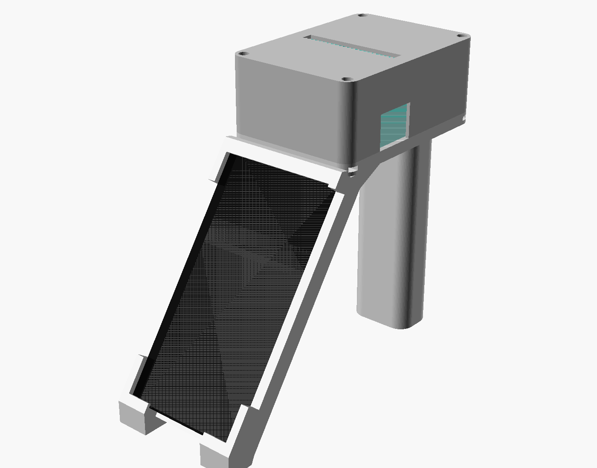

# 3dhaz – hordozható fizetési terminál

MXW01 (Fun Print) mini hőnyomtató + Samsung Galaxy S21 FE (tok nélkül) + mágneses Qi töltő, egy kézben fogható darabban (#1).

| oldalnézet | hátulnézet |
|---|---|
|  |  |

## Felépítés
- **Felül:** zárt nyomtatóház. Csak a papírnyílás látszik a tetején, fogazott tépőéllel.
- **Elöl-lent:** telefonbölcső 55°-ban. A kijelző teljesen szabad; a telefont alul és felül egy 2 mm-es perem tartja (csak a kávát takarja), így hordozás közben sem esik ki.
- **Hátul:** markolatláb, belül kábel- és tápelosztó-tér, alul a USB-C táp bemenete.
- A papír a ház tetején jön ki, a telefon fölött és mögött, így nem ütközik bele.
- Nincs talplemez és hátsó farok. Asztalon a bölcső két talpán és a lábon áll.

## Fő méretek (mm)
| | |
|---|---|
| Teljes befoglaló méret | 87 (sz) × 224 (mély) × 199 (mag) |
| Nyomtatóház | 87 × 124,4 × 54,4 (padló 7,4 + burkolat 47) |
| Nyomtató-üreg | 82,6 × 107,5 (R16,3) + fülzseb 42 × 13,75, magasság 44,6 |
| Papírnyílás | 67 × 8, a doboz elejétől 53,5–61,5, fogazott első éllel |
| Telefonzseb | 76,5 széles, 159,2 hosszú (3,5 mm hely a behelyezéshez), 55° |
| Qi zseb | Ø58 × 10,8 a hátlapban, középpontja 72 mm-re a telefon aljától, 1,2 mm héj a telefon felé |
| NFC-zóna | a telefon felső 52 mm-e mögött: 3 mm vékony műanyag, fém nélkül, hátulról szabadon megérinthető |
| Markolatláb | 44 × 30 (R10), 145 magas, üreges (39 × 25 belül) |
| Bekapcsoló ablak (bal) | a nyomtató hátuljától 6–45, aljától 6–38 |
| Papírkinyitó ablak (jobb) | 28 × 23, alul nyitott; a burkolat így rácsúszik a kiálló reteszre |
| USB-C a nyomtatón | 16 × 12 kivágás hátul, plusz belső átvezetés a padlón át a lábba |

## Részek és nyomtatás
- `stl/terminal_base.stl` / `.3mf`: bölcső + markolat + nyomtatóház-padló. Már nyomtatási helyzetben van: a padló teteje fekszik az ágyon, magassága 152 mm. 220 × 220-as ágyon átlósan fér el, 256-oson simán. A bölcső kis peremeihez tree support ajánlott.
- `stl/terminal_top.stl` / `.3mf`: nyomtató-burkolat. Tetejével lefelé nyomtatandó, támasz nem kell.
- Ajánlott: PLA/PETG, 3–4 fal, 20 % infill.
- Forrás: `cad/terminal.scad` (`PART = "base" | "top" | "assembly"`).

## Összeszerelés
1. **Qi modul:** a kerek Qi + mágnesgyűrű modul (Ø50–56, 6–8 mm) hátulról a zsebbe kerül, ragasztóval vagy kétoldalas szalaggal. A kábele a jobb oldalsín zárt csatornájában fut fel, a nyakon és a padlón át a lábba, ezért **beszerelés előtt** kell befűzni.
2. **Tápellátás:** a lábba beépíthető USB-C aljzat megy (13 × 7,5-ös nyílás, opcionálisan 2 db M2,5 furattal), mögé egy 1→2 USB-C táp-elosztó. Az egyik ág a nyomtatóhoz, a másik a Qi modulhoz megy.
3. **Nyomtató:** a fülekkel hátrafelé kell a padlóra tenni. A USB-C kábelhez 90°-os, lefelé forduló dugó kell, ami a fülek közötti nyíláson át a lábba megy le.
4. **Burkolat:** rá kell húzni a nyomtatóra, majd 4 db M3 × 14 csavarral felülről rögzíteni (mély süllyesztés), az M3 anyák oldalról tolhatók be a padlóba. **Az első két csavar legyen nejlon**, hogy a telefon közelében ne legyen fém.
5. **Telefon:** a tetejét fel kell tolni a felső perem alá, aztán az alját a bölcsőbe nyomni és visszacsúsztatni. Kivétel fordított sorrendben.

**Papírcsere:** 4 csavar ki → burkolat le → nyomtató kivehető (vagy helyben nyitható).

## Fontos megjegyzések
- **Az S21 FE nem MagSafe-es, nincs benne mágnes.** Ahhoz, hogy a mágneses igazítás „odaugrassza”, egy vékony mágneses gyűrűmatrica kell a telefon hátára, **középre vagy kicsit lejjebb, a Qi tekercs köré**, és semmiképp sem a felső harmadba. A bölcső peremei matrica nélkül is megtartják a telefont.
- A telefon felső harmada mögött nincs fém, mágnes vagy kábel. A Qi kábel a telefon szélességén kívül, az oldalsínben fut.
- A nyomtató mechanikája (motor, nyomtatófej) a papírnyílás környékén van, kb. 55 mm-re a telefon tetejétől. Ha a kártyás érintés gyenge, ezt érdemes ellenőrizni.
- A Qi zseb helyét (72 mm-re a telefon aljától) a tekercs valós helyéhez igazítani kell. A `.scad` fájlban ez a `qi_s` paraméter.
